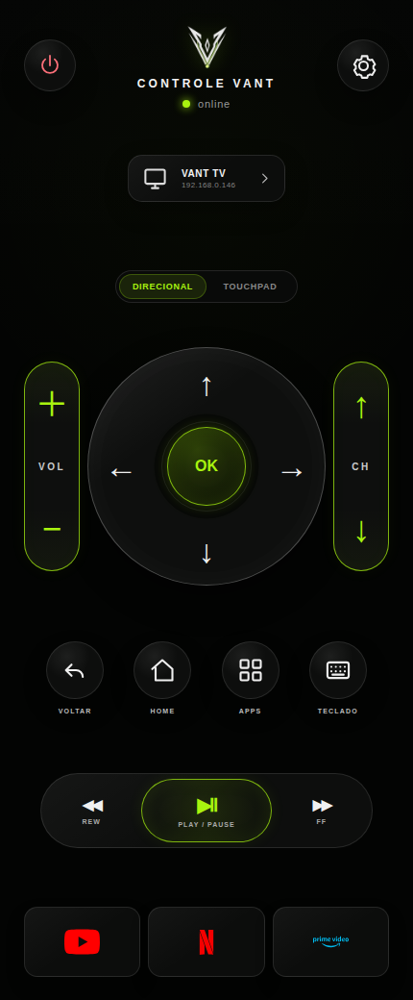

<div align="center">
  
  <h1>VANT Remote</h1>
  <p>O controle da sua TV Samsung, no navegador.</p>
  <p>
    
    
    
    
  </p>
  
</div>

## Sobre o projeto

Controle remoto web para TVs Samsung compatíveis com a API de controle por WebSocket. O celular ou computador abre a interface no navegador; um servidor Node.js na rede local se comunica com a televisão.

O projeto reúne uma interface responsiva com identidade visual VANT, controles de navegação e uma etapa de configuração da TV. O processamento acontece localmente, sem serviço de nuvem obrigatório.

**Conexão:** a implementação atual usa rede local (Wi-Fi ou Ethernet) e WebSocket. Não há implementação de Wi-Fi Direct neste código.

## Recursos implementados

| Recurso | Como funciona |
| --- | --- |
| Direcional e OK | Navegação por teclas da API Samsung |
| Volume e canais | Botões com repetição ao manter pressionado |
| Home e voltar | Acesso às ações de navegação |
| Reprodução | Play/pause, avançar e retroceder |
| Aplicativos | Atalhos para YouTube, Netflix e Prime Video |
| Teclado | Envio de texto ao campo ativo da TV |
| Touchpad | Interface e comandos de movimento/clique |
| Configuração | Busca de TVs, IP manual e pareamento |
| Manifesto web | Manifesto, ícones e service worker incluídos |

A disponibilidade de aplicativos, texto e mouse depende do modelo e do firmware. O botão Power está desabilitado na interface porque ainda não foi validado.

## Executar localmente

Requisitos: **Node.js 22+**, npm e uma TV Samsung compatível na mesma rede do servidor. A versão usada na verificação local foi Node.js 24.

```bash
git clone https://github.com/victor-hugos/vant-tv-remote.git
cd vant-tv-remote
npm ci
cp config/tv.example.json config/tv.json
npm start
```

Abra **http://localhost:3000**. Acesse a engrenagem, procure a televisão ou informe seu IP e aceite a solicitação na tela da TV quando aparecer.

O arquivo `config/tv.json` é local e fica fora do Git. O exemplo usa um IP fictício; configure sua televisão antes de enviar comandos.

Se a porta estiver ocupada, use no Linux/macOS:

```bash
PORT=3001 npm start
```

Para abrir pelo celular, use `http://IP_DO_COMPUTADOR:3000` (ou a porta escolhida). Celular, servidor e TV precisam ter conectividade entre si. Redes de convidados e isolamento entre dispositivos podem impedir a comunicação. Instalação como aplicativo e recursos do service worker dependem do navegador e de contexto seguro; a interface também funciona como página web.

## Arquitetura

```text
Navegador (celular ou computador)
              |
          HTTP / API
              |
       Servidor Node.js
              |
       WebSocket Samsung
              |
          Smart TV
```

O servidor usa o módulo HTTP nativo do Node.js. A única dependência de execução declarada é `ws`. O frontend usa HTML, CSS e JavaScript sem etapa de compilação.

```text
config/              Exemplo de configuração (sem token)
docs/images/         Captura real da interface
public/              Interface, ícones, manifesto e service worker
scripts/             Diagnósticos manuais com a TV
src/
  config.js          Leitura e gravação da configuração local
  server.js          Servidor HTTP, arquivos estáticos e API
  samsung/           Cliente WebSocket, descoberta, teclas e apps
```

## Verificação

```bash
npm run check
```

Este comando verifica a sintaxe do servidor, do cliente Samsung e do JavaScript principal da interface. A integração contínua executa essa checagem em Node.js 22 e 24.

Na preparação desta versão, foram verificados: carregamento da interface e dos recursos estáticos, status do servidor, configuração pública sem token, rejeição de comandos e entradas inválidas e retorno 404 para uma rota inexistente. Uma Samsung UN40KU6300 respondeu à consulta de identificação na rede. **Pareamento e comandos físicos ainda precisam de validação nesta cópia.**

Os comandos abaixo são testes manuais e **enviam ações reais à TV**:

```bash
npm run test:remote  # Conecta e envia Volume +; pode salvar token local
npm run test:keys    # Envia uma sequência de teclas; padrão: porta 3001
```

Para alterar a URL do teste de teclas:

```bash
BASE_URL=http://127.0.0.1:3000 npm run test:keys
```

## Uso e limites

- Use apenas em uma rede local confiável: a API de controle não possui autenticação de usuários.
- Não exponha o servidor diretamente à internet nem configure encaminhamento público de portas.
- O servidor escuta em `0.0.0.0` por padrão. Para acesso somente neste computador, use `HOST=127.0.0.1 npm start`.
- O token de pareamento permanece em `config/tv.json`; nunca o publique.
- Conexões WSS permitem o certificado local da TV sem validação de autoridade certificadora.
- A compatibilidade precisa ser verificada por modelo. Os atalhos não garantem que o aplicativo esteja instalado ou disponível na região.
- Os scripts exploratórios em `scripts/` podem conter endereços locais de desenvolvimento; revise-os antes de executar.

## Autoria

Projeto VANT, apresentado por [Victor Hugo](https://github.com/victor-hugos).

Samsung, YouTube, Netflix e Prime Video são marcas de seus respectivos titulares. Este projeto é independente, sem afiliação oficial com essas empresas.
